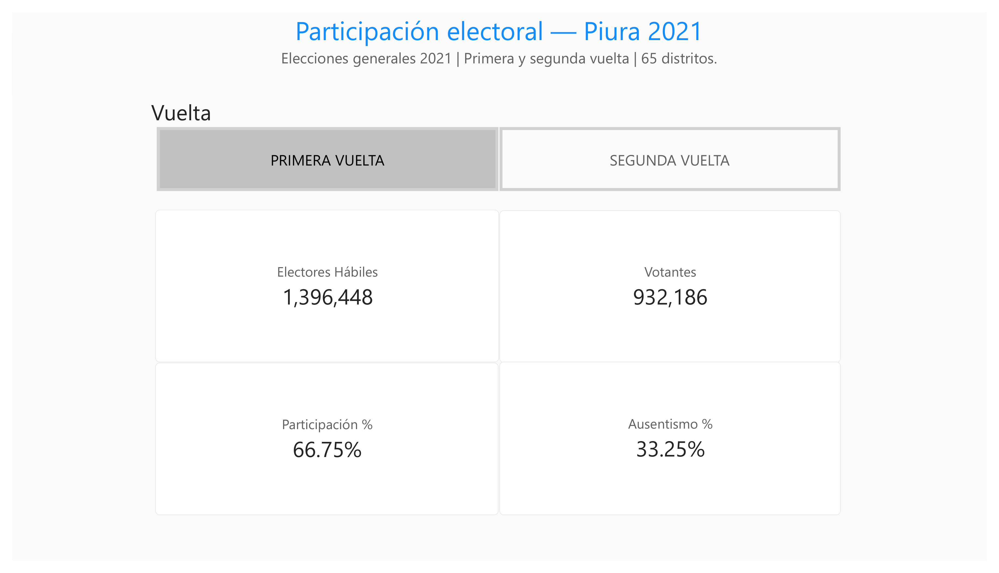
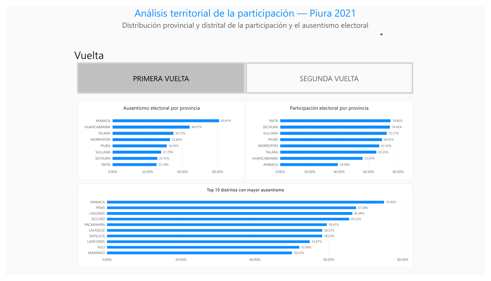
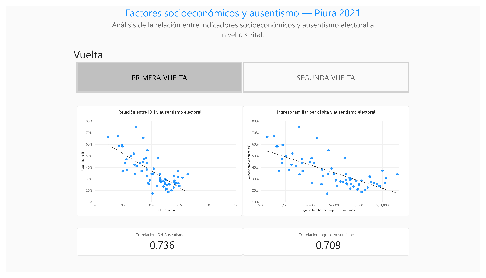
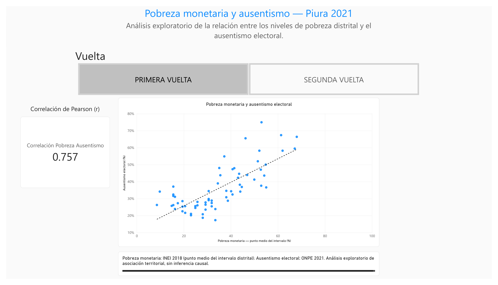
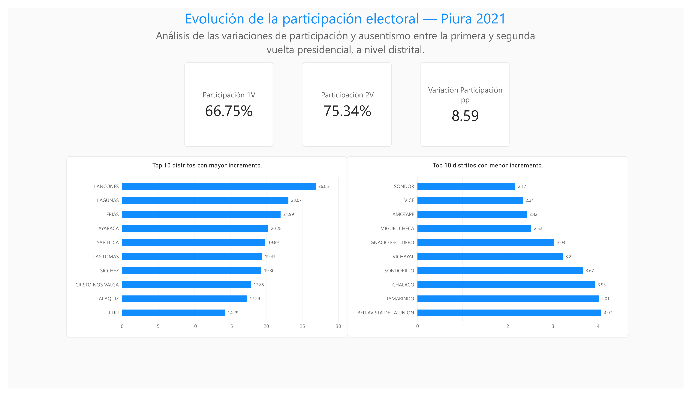
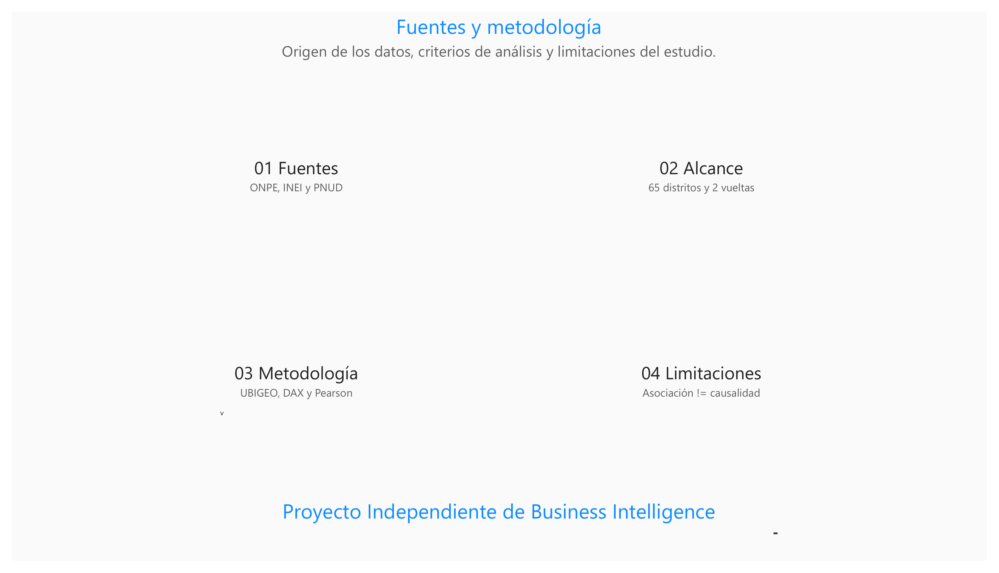

# Participación electoral y factores socioeconómicos en Piura (2021)

**Proyecto independiente de Business Intelligence** que analiza, a nivel distrital, la participación y el ausentismo en las dos vueltas de las elecciones presidenciales de Perú de 2021, y su asociación estadística con indicadores socioeconómicos del departamento de Piura.

> **Alcance:** 65 distritos, 8 provincias y dos vueltas electorales. El análisis utiliza información pública agregada; no identifica ni permite inferir decisiones de votantes individuales.

## Vista previa del dashboard

| Resumen electoral | Análisis territorial |
|---|---|
|  |  |

| Factores socioeconómicos | Pobreza y ausentismo |
|---|---|
|  |  |

| Comparación entre vueltas | Fuentes y metodología |
|---|---|
|  |  |

## Pregunta de investigación

¿Qué factores socioeconómicos, demográficos y territoriales están asociados con las diferencias de participación y ausentismo electoral entre los distritos del departamento de Piura?

## Principales resultados

| Indicador | Primera vuelta | Segunda vuelta |
|---|---:|---:|
| Electores hábiles | 1 396 448 | 1 396 448 |
| Votantes | 932 186 | 1 052 088 |
| Participación | 66,75 % | 75,34 % |
| Ausentismo | 33,25 % | 24,66 % |

La participación aumentó **8,59 puntos porcentuales** entre ambas vueltas.

En la primera vuelta, a nivel distrital, se observaron las siguientes **correlaciones de Pearson con el ausentismo**:

- Pobreza estimada (punto medio del intervalo): **r = +0,757**.
- Índice de Desarrollo Humano (IDH): **r = −0,736**.
- Ingreso familiar per cápita: **r = −0,709**.

Estas cifras describen **asociaciones estadísticas entre distritos**; no establecen causalidad ni describen el comportamiento de personas individuales.

## Herramientas y enfoque

- **Power BI Desktop:** modelado de datos, medidas DAX y visualización interactiva.
- **Power Query:** preparación e integración de fuentes.
- **Modelo dimensional:** dimensión territorial por UBIGEO y tablas de hechos de participación, pobreza y desarrollo.
- **Análisis descriptivo y correlacional:** tasas ponderadas, diferencias en puntos porcentuales y coeficiente de Pearson.

## Archivos principales

- [`powerbi/Participacion_Electoral_Piura_2021.pbix`](powerbi/Participacion_Electoral_Piura_2021.pbix): dashboard editable en Power BI Desktop.
- [`powerbi/Participacion_Electoral_Piura_2021.pdf`](powerbi/Participacion_Electoral_Piura_2021.pdf): exportación estática del informe.
- [`images/`](images/): capturas de las seis páginas del dashboard.
- [`docs/metodologia.md`](docs/metodologia.md): alcance, metodología y limitaciones.
- [`docs/fuentes.md`](docs/fuentes.md): fuentes y política de datos.

> Los datasets originales no se redistribuyen en este repositorio. Para reproducir o actualizar el análisis es necesario obtener las fuentes originales y configurar sus rutas en Power Query.

## Estructura del proyecto

```text
Electoral2021/
├── data/           # Datos locales excluidos de Git
│   ├── raw/
│   ├── processed/
│   └── external/
├── notebooks/      # Reservado para análisis futuros
├── powerbi/        # PBIX y PDF
├── sql/            # Reservado para consultas futuras
├── src/            # Reservado para scripts futuros
├── web/            # Reservado para una futura interfaz web
├── images/         # Capturas del dashboard
├── docs/           # Documentación
├── .gitignore
└── README.md
```

## Consideraciones e independencia

El análisis combina resultados electorales de **2021** con indicadores socioeconómicos de **2018–2019**. La pobreza distrital se aproxima mediante el punto medio de un intervalo publicado. Las correlaciones pueden variar con el filtro de vuelta electoral.

**Este es un proyecto independiente de Business Intelligence**, elaborado con datos públicos y agregados. No representa, está afiliado ni expresa apoyo a ninguna organización política. Las asociaciones territoriales no permiten inferir conductas individuales ni relaciones causales.

## Autoría

**Joel Sebastian Lertua Coico** — Proyecto de portafolio de Business Intelligence.
